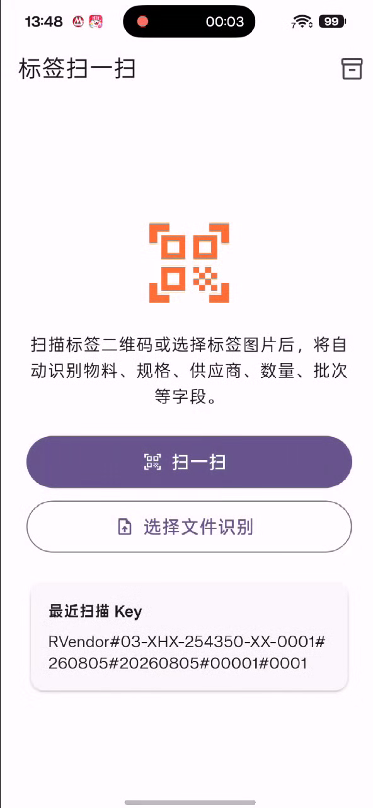
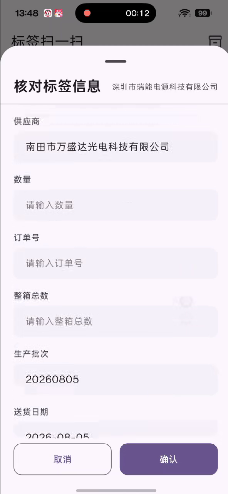
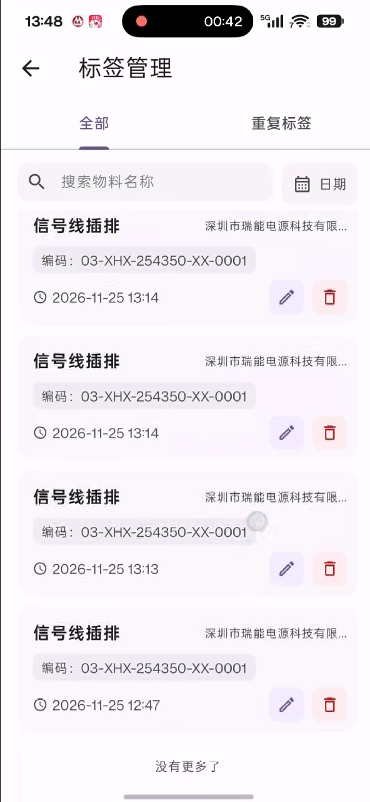
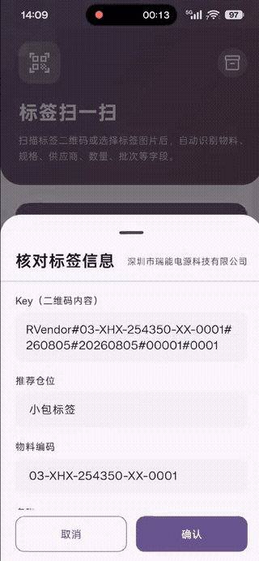

# scan_label_zf

物料标签扫码识别助手（Flutter，支持 Android / iOS）。

扫描标签上的二维码定位标签，再通过本地 PaddleOCR 识别文字，自动解析出物料编码、物料名称、生产批次、数量、整箱总数、推荐仓位等字段，确认后保存到本地 SQLite，并提供管理、筛选、编辑与重复清理能力。**识别与存储全部在本地完成，无需联网。**

## 功能特性

### 扫一扫识别
- 二维码扫描（mobile_scanner）+ PaddleOCR 本地推理（ONNX Runtime），离线可用
- **稳手拍摄**：加速度计检测手机持稳后自动抓帧（1080p），避免手抖拍糊；支持"立即识别"手动兜底，无传感器设备自动降级为定时拍摄
- 字段解析采用行内序列解析，适配供应商模板与小包模板；物料编码、生产批次可由二维码内容兜底
- 识别结果弹层可编辑校正，物料编码 / 物料名称为空时红色警示（不阻断保存）；也支持从相册选择图片识别

### 标签管理
- **全部 / 重复标签**双 Tab，可点击或左右滑动切换
- 物料名称搜索（300ms 防抖）、录入日期区间联动筛选，对两个 Tab 同时生效
- 下拉刷新、上拉加载更多（全部每页 30 条，重复每页 10 组），底部加载状态提示
- 记录支持编辑与删除（删除需确认）
- **重复清理**：编码一致即判定为重复，按编码分组展示并标注重复次数，空编码不参与判定

### 本地存储
- SQLite（sqflite）持久化，筛选、排序、分页、重复分组全部走 SQL
- 名称、录入时间、物料编码均建有索引，支持上万条记录
- 数据库版本 2，老数据自动迁移

## 截图

| 首页 | 识别结果核对 | 标签管理 |
| :--: | :----------: | :------: |
|  |  |  |

## 演示



管理页浏览与"重复标签"切换演示；[观看完整演示视频（51 秒，含扫码识别全流程）](screenshots/demo.mp4)。

## 技术栈

| 能力 | 依赖 |
| ---- | ---- |
| 二维码扫描 | mobile_scanner |
| OCR 文字识别 | paddle_ocr_native（ONNX Runtime + OpenCV） |
| 稳手检测 | sensors_plus（加速度计） |
| 本地存储 | sqflite（sqlite3 原生库） |
| 图片选择识别 | file_picker |
| 路由 | go_router |

## 运行与构建

```bash
flutter pub get
flutter run                  # 真机 / 模拟器调试
flutter build apk --release  # 打包 Android release
flutter test                 # 运行全部测试（31 个用例）
```

### 平台要求
- **Android**：minSdk 26（Android 8.0+），仅打包 `arm64-v8a`；需相机权限
- **iOS**：iOS 16.0+，静态链接 Podfile，需在 Mac 上先执行 `pod install`；`Info.plist` 已声明相机用途

### 国内构建加速（已内置）
- `pubspec.yaml` 中通过 `hooks.user_defines.sqlite3.url_pattern` 将 sqlite3 预编译库切换到 ghfast.top 镜像（保留 sha256 校验）
- Gradle 仓库使用阿里云镜像；第三方插件自带的 buildscript 由全局 `~/.gradle/init.d/mirrors.gradle` 统一重定向（项目内备份：`android/mirrors.init.gradle`）

### 构建配置说明
- release 已关闭 R8 混淆与资源裁剪：ONNX Runtime 的 Java 类仅被 JNI 引用，混淆会误删导致 release 扫码闪退
- `android/gradle.properties` 关闭了 Kotlin 增量编译，规避 Windows 跨盘符（Pub Cache 在 C 盘、项目在 D 盘）编译崩溃；若依赖缓存与项目同盘符，可删除该配置恢复增量编译

## 目录结构

```
lib/
  main.dart                        # 应用入口，预热本地库
  pages/label_scan/
    label_scan_page.dart           # 首页（扫一扫 / 相册识别 / 标签管理入口）
    label_scanner_page.dart        # 扫码取景页（稳手检测、抓帧识别）
    hand_stability_detector.dart   # 稳手判定纯逻辑（可单测）
    label_ocr_service.dart         # PaddleOCR 识别封装
    label_field_parser.dart        # OCR 结果 → 字段解析
    label_scan_models.dart         # 字段与识别结果模型
    label_records.dart             # SQLite 存储（分页、筛选、重复分组）
    label_records_page.dart        # 管理页（双 Tab 框架与筛选）
    label_records_tabs.dart        # 全部 / 重复标签列表与记录卡片
test/                              # 字段解析、稳手检测、存储与管理页共 31 个用例
```
